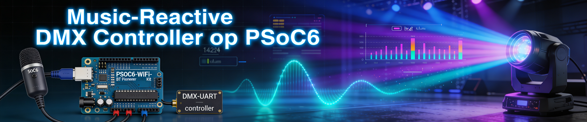
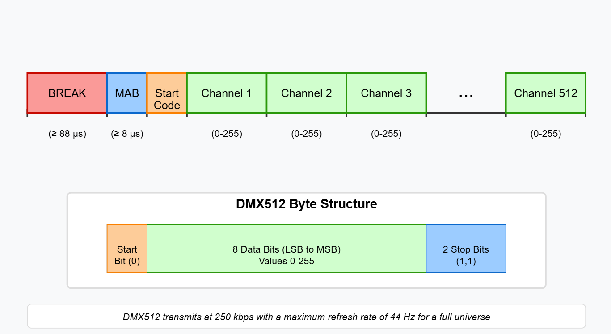
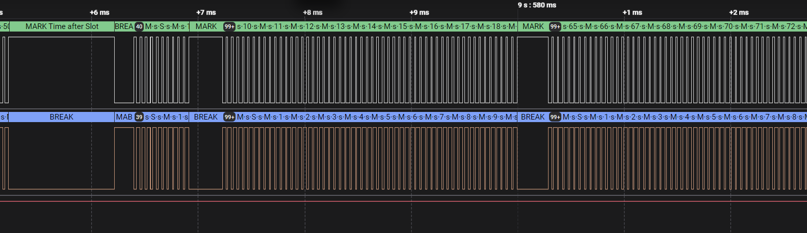
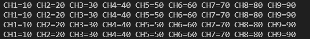

# Music-Reactive DMX Controller

## Overview

This project implements an embedded system on a PSoC6 that drives a DMX moving head and reacts to music input. The main purpose is to translate audio features such as beat, volume, and frequency content into expressive light movements, colors, and intensities.

---

### Sequence of Operation

This section explains what to expect once all hardware and software has been set up according to [**Getting Started**](##Getting-Started).

1. Connect the board to your computer via USB.
2. The green LED will automatically turn on to indicate the system is active.
3. A welcome message will appear in the serial terminal.
4. The user LED indicates PDM mic input.
5. Further instructions for controlling DMX channels are shown in the serial terminal

---

## Materials and Methods
- **[Hardware](./hardware/README.md)**: 
    - Fun Generation Pico Spot 20 LED (Moving Head Beam)
    - CY8CKIT-062-WiFi-BT (PSOC 6 WiFi-BT Pioneer Kit)
    - CY8CKIT-028-TFT (TFT Display Shield Board)
    - Pico-2CH-RS485 (DMX module)
    - Raspberry Pi Pico
    - RSD-150C-5 (DC-DC Power supply)
    - RSP-2400-48 (AC-DC Switching power supply)

- **Software**: overview of languages, libraries and tools used.
    - ModusToolbox
    - C/C++
    - Visual Studio Code
    - Platform IO (vsCode extention)

- **Methodology**: The project followed a structured approach using the kanban principle: each part of the system was first developed and tested separately, then combined into 2 boards one final main DMX controller and 1 DMX read controller for the led wall. Audio input (PDM), filtering, and DMX output, DMX input and LEDstrip write were validated step by step to ensure reliable communication, and responsive lighting behavior.

---

## Tests
For this project we tested different subcategories. the test folder contains the code or test files. More info can be found [here](./tests/README.md).

### DMX timings
We studied the DMX protocol to better understand how the signal is structured and transmitted. The diagram below gives a clearer overview of the protocol:

After gaining a better understanding of the signal format, we captured a real DMX signal from a professional lighting desk using a logic analyzer. The capture below shows the recorded waveform:

A deeper and more in detail dmx timings file and the capture files can be found in the [DMX Timings](./tests/Captures/DMXTimings.md) file.

### DMX with raspberry pi pico
We tested the functionallity of creating a DMX signal on a microcontroller. More specific the Raspberry Pi Pico, this helped us understand the dmx timings that are necessary to make the protocol work. We used the Waveshare Pico-2CH-RS485 to translate UART from th pico to a RS485 signal.

The DMX timings we found the best can be found [here](./tests/Captures/DMXTimings.md).

The code for sending DMX can be found [here](./tests/DXMTest/)

The image below shows the [movinghead](./docs/datasheets/c_372642_v2_r1_en_online.pdf) working with the rasperry pi pico. 

### Read DMX
To receive DMX data for the LED wall, we used the Pico-DMX library developed by jostlowe:

https://github.com/jostlowe/Pico-DMX/

The implementation uses a Waveshare RS485 module connected to the Raspberry Pi Pico's UART interface to receive DMX signals. The Pico-DMX library handles the DMX protocol and provides access to incoming channel values.

The code can be configured to read a specific number of DMX channels, allowing it to be adapted to different LED wall setups and channel requirements.

### PDM
The tests were conducted by playing music through the PDM microphone to evaluate its response to lower-frequency sounds. The objective was to verify that the low-pass filter could successfully isolate low-frequency audio signals and use them to control the user LEDs on the PSoC 6, causing them to blink in response to the detected beats.

After confirming the LED functionality, a moving head light was connected to the PSoC 6 to further test the system. The moving head was programmed to change its movement speed based on the detected BPM (beats per minute) of the music. As the BPM increased or decreased, the moving head would accordingly speed up or slow down, demonstrating real-time audio-reactive control.

---

## Getting Started

### LED Wall

#### Connections
1. Connect the **data wire** to **GPIO2** on the Raspberry Pi Pico.
2. Connect the shield to the **DMX** interface.
3. Power the LED wall with **5V**.

More info on the LED wall setup can be found [here](./firmware/ledWallController/ledWallController.md)
More info on the LED wall power setup can be found [here](./docs/LEDSTRIP.md)
More info on the LED wall DMX mode can be found [here](./docs/ledWallDMXMapping.md)

### PSoC6 Setup

#### CY8CKIT-028-TFT Connections
Connect the following pins from the PSoC6 to the CY8CKIT-028-TFT:

| PSoC6 Pin | Function |
|---|---|
| P10.4 | PDM_CLK |
| P10.5 | PDM_DATA |

#### Pico-2CH-RS485 Connections
1. Connect **P9.1** on the PSoC6 to the **GPIO0 TX** pin on the pico-2CH-RS485.
2. Connect the **DMX cable** to:
   - pico-2CH-RS485 **Channel 0**
   - the moving head fixture

#### Power Connections
Provide power to the devices as follows:

| Connection | Target |
|---|---|
| USB-C | PSoC6 |
| 3V3 | pico-2CH-RS485 pin 36 |
| GND | pico-2CH-RS485 pin 38 |

More info on the PSoC DMX setup can be found [here](./firmware/mainDMX/dmx.md)
More info on the PSoC PDM setup can be found [here](./firmware/mainDMX/PDM.md)

---

### Notes
- Double-check all wiring before powering the system.
- Ensure all devices share a common ground.
- Verify DMX channel configuration on the moving head fixture.

---

## Results

### LED Wall
The LED wall is controlled via DMX. It receives DMX values and converts them into the corresponding colors on the LED wall.

#### Status:
At the moment, the LED wall controller can receive DMX data. However, due to an issue, it cannot yet send data to the LED strip.

More details can be found in this [file](./firmware/ledWallController/ledWallController.md), and the code is available in [this](./firmware/ledWallController/) folder.

### DMX Controller

### status:

## Future Work and Issues

- Web-hosted user interface
- Capsense to control movinghead position and change settings
- Fix LED wall to work with DMX read.

## People

- **Mauro De Bruyn** – _Student_ – [GitHub](https://github.com/MauroDeBruyn)
- **Lennert Engelen** – _Student_ – [GitHub](https://github.com/akalen06)
- **Nick Driessen** – _Student_ – [GitHub](https://github.com/NickDriessen)
