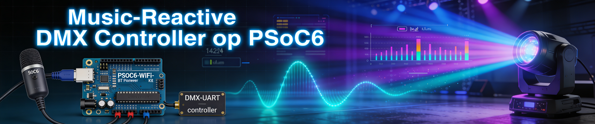

# Name of the Project

## Music-Reactive DMX Controller

This project implements an embedded system on a PSoC6 that drives a DMX moving head and reacts to music input. The main purpose is to translate audio features such as beat, volume, and frequency content into expressive light movements, colors, and intensities.

### Sequence of Operation

This section explains what to expect once all hardware and software has been set up according to **Getting Started**. It is intended as a guide for non-technical users.

1. Connect the board to your computer via USB.
2. The green LED will automatically turn on to indicate the system is active.
3. A welcome message will appear in the serial terminal.
4. The linear slider performs an automatic calibration and moves to the center.
5. Wait for a beep signal and then place the phone on the slider holder.

Follow any additional instructions shown in the terminal or on the interface.

## Materials and Methods

> 💡**Version-Control-Friendly Practices**
>
> Use **plain text formats** like Markdown or CSV files. These are readable on GitHub and well-suited for version control.
>
> Avoid linking to external files (e.g. datasheets or images). Instead, store them locally in a `media` or `datasheets` folder. External links can break when the source changes or if this repository is renamed, forked, or cloned.

- **Hardware**: 
    - Fun Generation Pico Spot 20 LED (Moving Head Beam)
    - CY8CKIT-062-WiFi-BT (PSOC 6 WiFi-BT Pioneer Kit)
    - CY8CKIT-028-TFT (TFT Display Shield Board)
    - Pico-2CH-RS485 (DMX module)
    - Raspberry Pi Pico

- **Software**: overview of languages, libraries and tools used.
- **Methodology**: brief description of the approach taken.

## Results

- Summary of key findings.
- Include charts, tables, or images as needed.
- Reflections on performance or reliability.

## Getting Started

Nothing more frustrating than finding good code but not knowing how to run it.

- [ ] Provide a step-by-step how-to guide here.
- [ ] Explain how to run the program.

## Future Work and Issues

- Planned extensions or improvements.
- Known bugs or limitations.
- Link to a issue if applicable, for example #1

## People

- **Mauro De Bruyn** – _Student_ – [GitHub](https://github.com/MauroDeBruyn)
- **Lennert Engelen** – _Student_ – [GitHub](https://github.com/akalen06)
- **Nick Driessen** – _Student_ – [GitHub](https://github.com/NickDriessen)
