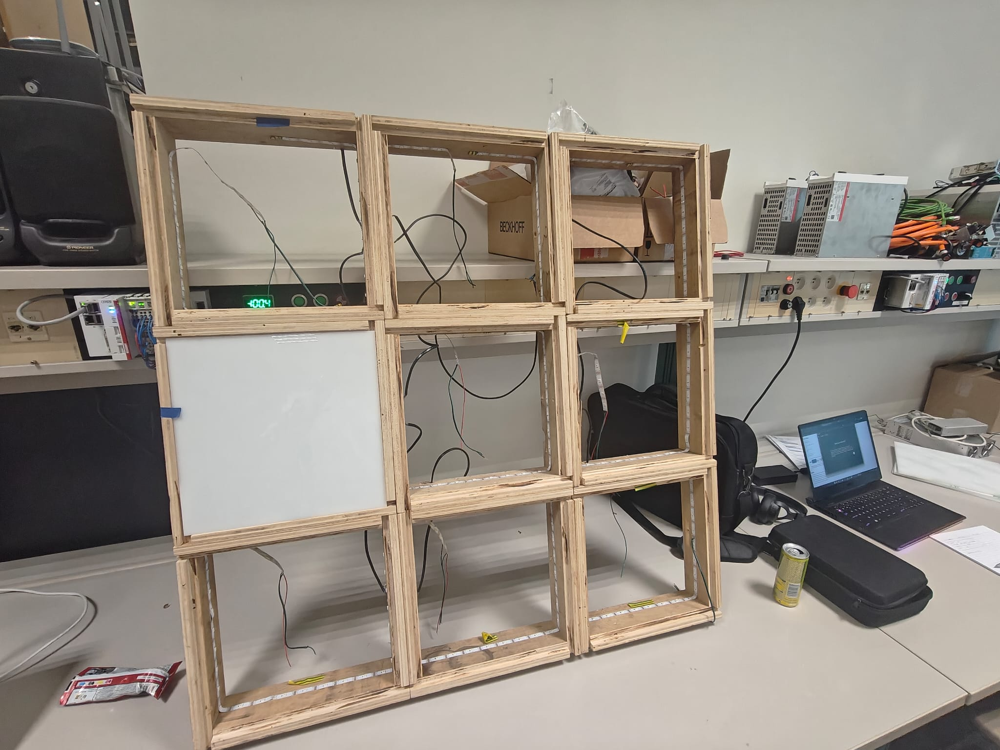

# LED Strip: Power & Calculation

The LED wall is equiped with a **5V WS2812b LED strip**.  
The LED's are mounted in a square as seen in the picture below.

## Specifications

- **Type:** WS2812b
- **Voltage:** 5V DC
- **LED's per square:** 36
- **Squares:** 9
- **Total amount of LED's:**  
  36 LED's × 9 squares = **324 LED's**

---

## Power calculation

A WS2812b LED uses a maximum of:

- **60 mA per LED** (Full white, RGB 100%)

### Maximale current
324 LEDs × 0.06 A = 19.44 A

👉 **Maximum current: ±19.5 at 5V**

### Maximum power
P = U × I
P = 5V × 19.44A = 97.2 W

👉 **Maximaal vermogen: ±97 W**

---

## Recommended power supply
### Recommended specefications:

- **5V**
- **minimum 20A**
---

## Important

### Power injection
Its recommended to use a power injection for a large amount of LED's

We will not be using this as each square will have its own line to the power supply. This means we will have 9 parallel supplies to the LED wall.

---

## Summary

| Parameter | Waarde |
|-----------|--------|
| LEDs total | 324 |
| Max current | ±19.5A |
| Max power | ±97W |

